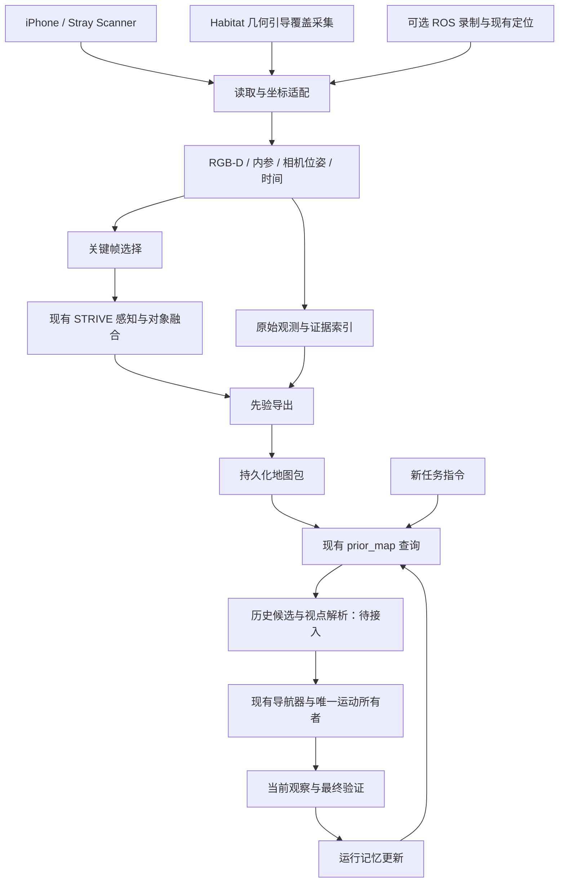

# STRIVE 轻量先验地图设计方案

更新日期：2026-10-30。状态：**实施中。独立 Habitat 采集、共享融合、地图导出/重载检索已跑通；手机导入器通过合成数据测试。地图语义质量、真实手机输入及历史视点导航尚待验收。**

当前实现与实测状态见 [HM3D 首轮采集记录](prior_map_capture_progress.md)。P7 无任务 baseline 巡视与几何路线已完成单场景同条件采集、统一建图和独立质量诊断；预测实例质量仍待改善。设计阶段表保持目标定义，完成情况以该记录中的证据为准。

## 实施清单状态（2026-10-30 提交整理）

| 阶段 | 当前证据 | 尚待完成 |
| --- | --- | --- |
| P1 统一协议 | 坐标、对象/地图身份、证据、两种视点与持久化已实现 | 随真实手机数据验证协议适用性 |
| P2 独立覆盖采集 | 多场景运行，输出区域、位置、RGB-D与覆盖报告 | 改善覆盖缺口 |
| P3 几何诊断 | 投影、量程、网格正反面诊断已运行 | 部分跨视角残差仍待归因 |
| P4 共享融合 | STRIVE共享算法、DualMap独立对照可运行 | 实例误关联和类别错误仍未解决 |
| P5 导出重载 | 独立重载检索、证据哈希、无损压缩已验证 | 地图检索质量尚未正式验收 |
| P6 多场景/多层 | 两个额外场景采集及高度跨度诊断 | 全面覆盖、跨层质量与成本验收 |
| P7 连续/巡视对照 | baseline巡视及连续、离散、抽帧对照已完成样例 | 扩大匹配对照，保留质量指标 |
| P8 新指令导航 | 查询绑定、历史视点、实际2m平移与到达已验证 | 同一会话当前检测、补拍、最终验证及任务完成 |
| 手机与实物 | Stray Scanner导入及合成测试 | 真实采集、重定位、实物闭环验收 |

P1–P5 的基础链路已贯通，地图质量整体尚未验收。P8 当前是分段/运动诊断证据，不能报告完整任务成功。最新一轮中断前只读取了到达处理代码，尚未新增“同会话到达后感知”实现。

## 1. 设计决策

**实物用 iPhone 采集，仿真用现有 Habitat 采集；两者提供带位姿的 RGB-D，复用 STRIVE 感知、对象融合和导航，通过现有 `prior_map` 保存与查询先验。**

**首阶段交付“可靠观测＋几何诊断＋可重载预测地图与检索证据”，导航接入在地图质量通过后开展。** 仿真优先实现独立、几何引导的覆盖采集，baseline 巡视改造后移。协议先冻结，采集、融合、存储分别验收。优先减少新增依赖和重复实现，再通过实测决定是否优化建图计算量。

| 组成 | 本版选择 | 使用范围 |
| --- | --- | --- |
| 实物离线采集 | Stray Scanner，带 LiDAR 的 iPhone | RGB、深度、置信度、内参、相机位姿 |
| 备选手机输入 | Record3D | 需要其数据格式或 USB 流式输入时接入 |
| 仿真采集 | 维护中的 Habitat 环境＋独立覆盖采集器 | 连通区域、位置与视角显式规划；连续巡视后续对照 |
| 默认建图 | 现有 STRIVE 检测、分割与对象融合 | 对象级地图、已有房间信息与观察点 |
| 先验消费 | 现有 loader、memory、query 与策略接口 | 搜索上下文、排序；后续接历史视点 |
| 独立建图对照 | DualMap | 相同观测输入下比较质量、时间和资源 |
| 可选布局输入 | Apple RoomPlan | 房间结构和大型家具先验 |

HOV-SG、Hydra 和完整 OK-Robot 系统保留为技术参考。首版采用一个默认建图器和一个独立对照，不增加插件系统、第二套导航状态机或新的通用建图框架。

**“集成轻量”和“运行轻量”分别验收。** 手机输入减少采集与位姿获取的工程工作；现有检测器的计算成本仍需测量。手机负责采集，STRIVE/DualMap 语义处理运行在工作站。

## 2. 当前基础与待实现边界

本次改写核对了 `prior_map/contracts.py`、`policy_adapter.py`、`real_robot.py` 等接口。下表的“已有”表示源码中存在相应能力，不代表新地图流程已经端到端运行。

| 能力 | 当前基础 | 本版工作 |
| --- | --- | --- |
| 先验协议 | `PriorMapData`、`PriorObject`、`PriorRoom`、拓扑 | 继续使用 canonical JSON |
| 观测摘要 | `PriorObservationRecord` | 增加外部证据索引；摘要与完整观测分开 |
| 加载、查询、对齐 | `loaders.py`、`memory.py`、`query.py`、`alignment.py` | 复用并验证新产物 |
| 实物语义输入 | `backends/ros/scene.py` 与 `SemanticMapSnapshot` | 确认累计地图来源及字段完整性 |
| 仿真对象地图 | 当前 mapper 与 Habitat 适配 | 提取累计预测结果，隔离任务相关初始化 |
| 策略接入 | 先验排序和上下文；`ranking_only` | 第一阶段沿用；第二阶段解析历史视点 |
| 手机数据 | Stray Scanner 导入器及合成数据测试已实现 | 真实扫描的几何与重定位验收 |
| 历史实例导航 | 已有查询绑定与历史视点运动到达记录 | 完成同会话取证、最终验证与任务闭环 |
| 实物跨次定位 | 当前验收情况未确认 | 与地图生成分开验收 |

旧版布局生成命令、BEV 和接口说明保留在 [历史参考](prior_map_legacy_reference.md)。现有实现受本版目标约束逐步迁移，文档更新本身不改变运行行为。

## 3. 数据流与职责



- 采集器记录观察事实、标定与位姿。
- 现有 mapper 负责对象关联和几何融合。
- 导出器负责协议转换、引用关系和文件落盘。
- 查询服务提供历史候选、排序与证据。
- 目标解析与导航服务产生当前可执行位置。
- 最终验证器使用当前证据判断任务完成。

历史对象可以支持前往已记录区域；它尚未进入当前视野时，也可以发起导航。运动目标由领域服务解析，执行仍经过现有运动所有者。历史类别和位置作为待核实信息，到达后以当前观察更新。

## 4. 实物采集：iPhone 离线扫描

### 4.1 默认使用 Stray Scanner

采集设备需具有应用支持的 LiDAR 能力，具体机型、应用版本与导出字段在首次采集时记录。首版离线文件传输便于复放和比较，不要求建立手机实时 ROS 链路。

官方格式包含：

```text
scan/
  rgb.mp4
  depth/                 # 16-bit PNG，官方格式单位为毫米
  confidence/            # 深度置信度
  odometry.csv           # 帧号、时间、位置、四元数；新格式含逐帧内参
  camera_matrix.csv      # 兼容用途内参
  imu.csv
```

读取器按实际文件头识别版本。使用逐帧内参时，明确其对应分辨率；旧数据只提供会话内参时，记录这一来源。RGB 与深度尺寸不同时，需要按采集器标定约定完成对应，不能直接共用未缩放的像素坐标。

原始导出保留不变，读取器负责毫米到米、位姿方向和坐标轴转换。首个样本通过投影可视化确认约定后，固定该格式版本的转换。

来源：[Stray Scanner](https://github.com/strayrobots/scanner)、[官方格式](https://github.com/strayrobots/scanner/blob/main/docs/format.md)。

当前导入器实现、上游版本及测试边界见 [Stray Scanner 适配说明](prior_map_stray_scanner.md)。真实手机几何验收仍未完成。

### 4.2 采集流程

1. 从明确的起始区域扫描，覆盖通道、地面和待使用区域。
2. 对重要物体保留正面及不同方向观察，减少模糊与遮挡。
3. 保留完整原始记录，停止后传至工作站。
4. 先检查深度尺度、位姿和多帧投影，再运行语义建图。
5. 保存地图及采集范围，随后使用新指令检验检索与导航。

手机相机轨迹记录“人在哪里拍摄”。导航观察点需要结合地面、底盘尺寸和当前可达性产生，手持相机高度不能直接作为底盘目标高度。

### 4.3 Record3D 与机器人原生采集

Record3D 作为备选读取源，按需要支持离线 `.r3d` 或 USB RGB-D 流。DualMap 已有对应运行入口，适合独立测试。首版先完成 Stray Scanner 一种手机输入，避免同时维护多个未验收适配器。

机器人原生模式继续使用现有相机、定位、检测与 SysNav 语义地图。若最终 `SemanticMapSnapshot` 仅含局部对象，导出应访问现有累计地图或已有对象更新记录；最后一帧的可见对象不能代表完整巡视结果。确定来源后复用同一导出函数，保留各输入的来源标识。

## 5. 仿真采集：独立几何引导覆盖，连续巡视后移

### 5.1 采集目标和信息边界

Habitat 可提供可通行点、连通分量、路径查询与指定姿态的 RGB-D 渲染。高质量语义记忆仍需经过采集规划、投影和实例融合。首阶段用独立采集器隔离 baseline 探索、任务初始化和控制器失败的影响。

允许采集器使用 NavMesh 与仿真相机位姿，manifest 明确标记几何辅助和 GT 位姿。预测建图输入仅包含实际渲染的 RGB-D、标定和位姿；episode goals、语义实例标注和成功指标保留在独立评测侧。采集用 NavMesh 数据留在采集诊断产物中。

### 5.2 区域、位置与视角生成

1. 枚举 NavMesh 连通区域，记录 island、面积、高度范围、纳入状态及排除原因。楼层与连通分量分别表示，一个连通分量可以跨楼层。
2. 在选定区域生成有空间间隔的候选点，检查贴近障碍物、采样重复和区域空缺。保留实际候选清单与种子。
3. 给候选点配置相机高度和多方向视角；先覆盖水平方向，再根据观察缺口补充俯仰或位置。
4. 渲染并检查有效深度、视野与跨帧重叠。NavMesh 可站立只证明地面位置可用，相机位姿需另做检查。
5. 根据位置与观察覆盖补采，固定预算内仍存在的缺口写入报告。

水平视角间隔可按下式设计初值：

\[
\Delta\theta\leq(1-\rho)\,\mathrm{HFOV},
\]

其中 \(\rho\) 为期望角度重叠比例；真实图像重叠受遮挡与深度影响，以渲染检查为准。采样间距、高度和俯仰配置先在单房间诊断中确定，再冻结用于扩大实验。

### 5.3 两种明确采集模式

| 模式 | 行为 | 验收范围 |
| --- | --- | --- |
| `coverage_scan` | 在检查过的相机姿态直接渲染，按区域和空间邻近顺序组织 | 首阶段数据构建；不表示机器人真实执行了路线 |
| `continuous_walk` | 连通区域内沿路线实际移动、途中采集 | 后续连续性、在线建图及 baseline 探索对照 |

互不连通区域按不同采集段记录。离散视图保留重叠和分组，依赖连续跟踪的建图模块单独验证适用性。直接设定姿态不能伪造动作成功或连续运动记录。

baseline 的当前房间优先、路径距离选点和房间切换在 P7 接入。届时再分离目标类别、`distance_to_goal`、任务停止与建图初始化，不将整个 ObjectNav 生命周期作为首阶段采集依赖。

### 5.4 覆盖检查与停止

对固定的区域检查点集 \(Q\) 与已采集位置集 \(V\)，报告：

\[
C_{\mathrm{position}}(r)=\frac{1}{|Q|}\sum_{q\in Q}
\mathbf{1}\!\left[\min_{v\in V}d_{\mathrm{nav}}(q,v)\leq r\right].
\]

检查点分布、区域分母、距离阈值和各 island 分项均保存；不连通距离按不可覆盖处理。这个指标表示位置覆盖，物体是否看清还需观察覆盖诊断。

观察诊断记录有效深度比例、观察方向、多视角重叠、新增可见几何以及对象证据的像素面积、距离和遮挡。GT 物体可见率或完整 mesh 表面覆盖只用于独立评测，并记录其评测范围。

停止条件为达到冻结的覆盖要求或预算耗尽。后者标记 `budget_exhausted` 并输出缺口；“执行结束”与“覆盖达标”是不同状态。

### 5.5 无损观测与重放

采集数据单独保存：

```text
captures/<scene_id>/<capture_id>/
  manifest.json
  regions.json             # 区域范围与纳入原因
  poses.jsonl              # 候选及实际采集姿态、采集段
  frames.jsonl             # 帧、传感器位姿、内参、文件引用
  actions.jsonl            # continuous_walk 的实际动作
  observation_groups.jsonl # 全景或多视角分组及完整性
  coverage.json            # 位置/观察指标与未覆盖区域
  rgb/                     # 无损 PNG
  depth/                   # float32 NPY，米制深度
```

原始观察在深度裁剪、图像拼接和展示转换前记录；8-bit 深度 JPG 仅作为预览。初始帧只写一次，动作后帧与实际传感器位姿一一对应。全景分组引用原始帧，预算导致的残缺分组按事实记录。

采集 manifest 保存场景资产、镜像与代码版本、传感器配置、深度定义、采集模式、位姿来源、随机种子、预算、完成状态和结束原因。仿真步骤始终记录，时间仅按明确的仿真时间定义填写。

场景版本与坐标一致时，不同任务可复用地图；HM3D 与 OVON 的复用需核对实际场景配置。既有目标/语义标注构图脚本保留为 oracle 对照，不进入预测观测建图主链路。

## 6. 最小观测与空间模型

每条逻辑观测为：

\[
o_t=(I_t,D_t,C_t,K_t,T^M_{C_t},t),
\]

**统一地图坐标：米制、右手系、Z 轴向上、房间二维边界位于 XY 平面；相机光学坐标为 X 向右、Y 向下、Z 向前。** 原始记录保留来源坐标，适配器转换后输出统一协议。矩阵使用行优先序列化、左乘列向量，明确 `camera_to_map`；JSON 中的四元数若出现，固定 `xyzw`。

Habitat 世界坐标、mapper 局部坐标、floorplan 和 ROS 坐标在适配边界转换。现有字段与代码不会因文档声明而自动迁移，需通过已知点投影和跨起点对齐测试。仿真 NavMesh 与实物定位/避障地图继续归各执行后端管理。

其中 \(C_t\) 为可选深度置信度，\(T^M_{C_t}\) 将相机坐标转换到地图坐标。协议明确深度单位、深度定义、四元数顺序、相机轴、世界轴和图像尺寸。

若深度表示相机光轴方向距离，像素投影为：

\[
p_M=T^M_C\begin{bmatrix}D(u,v)K^{-1}[u,v,1]^\top\\1\end{bmatrix}.
\]

射线距离与归一化深度先按输入定义转换。机器人输入由底盘位姿和相机外参得到：

\[
T^M_C=T^M_B T^B_C.
\]

对象证据关联为：

\[
(map\_id,object\_uid)\leftrightarrow observation\_id
\leftrightarrow(I,D,mask,K,T^M_C,t).
\]

对象身份沿用现有融合逻辑，并在本轮固定观察上验收，类别、几何与来源分别保存。历史对象 ID 与运行时跟踪 ID 建立显式对应。类别相同或 UID 字符串相同不足以证明跨地图实例相同。

## 7. 轻量建图与存储

### 7.1 复用范围

优先调用现有检测、分割、对象融合与查询。实施前检查 mapper 对 episode、任务词表、目标选择和在线推进状态的依赖，仅提取建图所需调用边界。本文不假设现有 Habitat mapper 已能直接接收手机记录。

首版基于固定通用词表构图时，manifest 记录词表及版本；地图覆盖能力受词表和巡视视野限制。原始关键帧支持后续按需补充识别，开放词汇查询的能力不等同于任意对象都已入图。

### 7.2 关键帧与证据

复用已有关键帧机制；若缺少机制，首先采用位移或转角触发，并检查模糊及有效深度。阈值通过同一小样本确定并写入配置，不在方案中规定未经验证的固定数值。

每个实例保存少量清晰、视角有差异的证据。首版采用稀疏对象记录与引用；全量点云作为已有建图器的可选附属输出。关系、房间信息优先保存已有结果，按任务需求补充查询。

原始扫描与运行时地图包分开保存。验收同时报告地图大小和完整采集存储，避免把外部图像存储从总成本中漏掉。

当前已实现独立证据子集导出：保留每个预测标签的样本、同帧分离 mask 复核对，再补充相机位置差异。实测包体积下降 STRIVE 3.03%、DualMap 36.15%；STRIVE 丢失一项跨帧 GT 冲突证据，故仍为实验路径，完整包保留。证据数下降、存储下降和地图质量改善分别验收；详见采集记录的“证据精简”章节。

### 7.3 统一地图包最小协议（设计冻结，基础读写已实现）

```text
prior_maps/<map_id>/
  manifest.json
  prior_map.json         # 现有 PriorMapData canonical JSON
  observations.jsonl     # 证据索引、标定与 camera_to_map
  viewpoints.json        # 两种明确类型的视点
  evidence/              # 少量精选图像、mask、必要深度
  features/              # 可选数组与模型身份
  geometry/              # 可选几何；不作为启动必需项
```

深度证据支持 `.npy` 与无损 `.npy.gz`，共同经 `load_depth` 读取，保持 float32、米制 optical-Z 与标定不变。压缩导出在 manifest 声明 `depth_storage.encoding=npy_gzip`，附源索引、编码文件与解码文件哈希回执。仅改变存储编码时保留 map_revision；证据删选与几何更新另行变更 revision。旧版直接使用 `np.load` 的消费者需更新后读取压缩包。

原始 capture 用于重建与离线复放；运行时按需加载 map，查询无需加载完整 RGB-D 或点云。所选证据复制到地图包或通过显式资源索引定位，避免依赖未声明的机器绝对路径。移动地图包后的引用解析纳入测试。

| 协议部分 | 冻结要求 |
| --- | --- |
| manifest | `schema_version`、`map_id`、`map_revision`、坐标约定、`source`、`capabilities`、`artifacts`；构建配置与采集引用 |
| 地图核心 | 保留 `PriorMapData` 的 scene/frame、对象、房间、拓扑和 metadata 结构 |
| 对象身份 | 新建地图分配 UUID map_id；`(map_id, object_uid)` 唯一；revision 标识地图版本；运行时 tracker ID 单独关联 |
| 对象属性 | 类别、位置、置信度、来源和可选房间；几何、证据及特征使用明确引用 |
| 证据 | observation ID、图像引用、可选深度/mask、内参、camera_to_map、时间或帧序号、关联对象 |
| 历史拍摄姿态 | `kind=observation_pose`：传感器当时的位置与朝向 |
| 导航观察点 | `kind=navigation_viewpoint`：领域服务处理后的候选，记录来源观察、适用底盘和可达性检查状态/版本 |

`scene_id` 标识环境，`map_id` 标识一次独立构建的地图；两者不由保存目录推导。STRIVE 与 DualMap 新导出均生成 UUID，重载、搬移、证据子集和无损压缩保留 map_id；证据子集另增 revision。已有以目录命名的实验包保留原值，其同名 map_id 不可用于跨包身份判别，读取旧记录时需同时绑定具体包与源回执。

`exact=True` 表示记录指向一个具体实例，类别正确性与任务满足另由证据判断。空房间列表表示未提供房间结构，不能推断为场景没有房间。历史可达性检查不替代执行时的当前可达性判断。

首版 `capabilities` 声明实际可用的对象位置、视觉证据、房间、视点与特征。查询明确返回缺失能力；可选数据按需加载。小型来源扩展写入约定的 metadata，跨模块依赖的字段在协议升级时正式定义。

现有 loader 的 dataclass 构造不自动接受任意新增顶层字段。保留 `prior_map.json` 兼容结构，用薄地图包入口验证版本、读取索引和调用原 loader；不把外部研究仓库的 Python 对象作为持久化格式。特征引用附编码器身份、维度与归一化约定。

视点不能由拍摄高度直接转换成运动目标。底盘姿态、地面、可达性由现有导航服务解析。拓扑边保存已有明确关系，空间距离近不足以建立通行连接。

## 8. 加载、查询与导航闭环

分两步接入，分别验收：

| 阶段 | 行为 | 完成证明 |
| --- | --- | --- |
| A：已有先验消费 | 加载导出地图，查询并影响现有搜索排序和上下文 | 重载、查询记录和策略调用证据 |
| B：历史视点导航 | 从历史候选解析可执行观察点，交给现有导航器 | 当前不可见对象的真实导航与到达验证 |

以下为职责伪代码，函数名称代表待绑定边界：

```python
memory = load_exported_prior(map_path)          # 复用现有 loader / memory
matches = query_prior(task_spec, memory)       # 复用现有 query
evidence = read_observation_refs(matches)      # 新增证据读取
viewpoint = resolve_historical_viewpoint(matches, evidence, scene)
goal = existing_goal_resolver(viewpoint, scene)
existing_motion_owner.submit(goal)
# 实际到达后，由已有取证与验证流程决定完成、补拍或继续搜索。
```

查询与地图读取保持只读；任务推进使用实际执行与验证事件。已有接口若仅接受当前 snapshot 视点，需要增加历史来源的明确绑定，不能把历史对象伪装成当前已观测对象。

观测不到目标时区分遮挡、观察不足与确认位置已变化。更新证据和状态后继续现有搜索策略。模型、解析或接口错误保留明确错误及运行记录。

## 9. 手机地图与机器人地图对齐

手机扫描坐标为 \(P\)，机器人导航坐标为 \(R\)，需要已知变换：

\[
p_R=T^R_Pp_P.
\]

首版可以使用已测量标记或人工对应点初始化。完整三维刚体配准需要足够的非退化对应约束；地面平面、重力和尺度已知的受限场景可使用二维对齐。采用何种模型及残差写入记录。

手机地图加载后，不要求机器人重建所有历史对象；机器人仍用自身定位与实时传感器执行。手持轨迹通过地面投影和导航检查产生候选，最终目标由现有规划服务提供。

机器人定位重启后，新里程计坐标 \(O\) 与旧地图 \(M\) 的关系为：

\[
T^M_B(t)=T^M_O(t)T^O_B(t).
\]

`alignment.py` 记录或应用对齐结果。估计 \(T^M_O\) 由外部定位或人工初始化提供。首次验收采用已知初始化；跨次自动重定位单独测试。位姿回环修正后，受影响对象应按更新后的关键帧位姿重融合或重建离线产物。

## 10. DualMap 对照与 RoomPlan 布局输入

### 10.1 DualMap：独立对照

官方提供 Record3D、离线数据、ROS 和 Habitat 相关入口，以及可查询的 iPhone/Replica 示例地图。先验证示例重载与查询，再将同一采集转换为其实际支持格式。

比较时固定采集、帧子集和查询集合，分别记录模型配置。分别报告输出对象、证据和地图资源；适配输出到 STRIVE 后，导航比较使用同一执行后端。

固定词表也是实验输入。12 类词表保留为早期工程对照；通用先验建图进一步验证任务无关的室内词表，避免只保存导航目标类别。上游已有 `gpt_indoor_general.txt` 包含 100 个具体概念和末尾 unknown 状态项。共享检测词表应保存具体概念，DualMap 适配器按其协议补充末尾 unknown，避免未分类 mask 被错误编码为最后一个真实类别。保持多词类别完整，禁止按场景标注补词。STRIVE 构建入口支持 `--classes-file`（一行一个概念），同时保留 `--classes`；两者互斥。实际类别列表写入构建记录，跨建图器对照先核对具体概念列表及顺序，再核对各自的状态项。

点采样参数随输入分辨率验证。当前 320×240 连续采集上，DualMap 的 4% 与 20% 采样消融已证明关联数量有明显差异；20% 仍为实验配置。类别稳定性、实例对应和地图覆盖分别验收，样本内正确的四个实例不能代替全场景质量证明。详细证据见实施记录。

DualMap 的速度收益、峰值显存、对象拆分与合并质量以本机测量为准。只有对照体现实际收益，再决定替换局部建图模块。

参考：[代码](https://github.com/Eku127/DualMap)、[手机入口](https://github.com/Eku127/DualMap/blob/main/resources/doc/app_runner_record_3d.md)、[离线地图格式](https://github.com/Eku127/DualMap/blob/main/resources/doc/app_offline_query.md)。

### 10.2 RoomPlan：可选布局来源

需要快速获得墙、门、房间结构和大型家具时，可将 `CapturedRoom` 结构化结果适配为布局先验。其支持类别与参数化几何服务于布局需求；细粒度开放词汇对象与视觉证据由 RGB-D 路线提供。

RoomPlan 为 Apple 平台框架，Habitat 通过其他来源生成同一先验协议。来自不同扫描会话的 RoomPlan 与 RGB-D 结果需显式对齐。

参考：[RoomPlan](https://developer.apple.com/documentation/roomplan)、[多房间及结构化导出](https://developer.apple.com/videos/play/wwdc2023/10192/)。

## 11. 实施顺序与最小修改范围

| 阶段 | 工作 | 修改边界 | 进入下一阶段的证据 |
| --- | --- | --- | --- |
| P1 | 冻结最小地图协议与当前接口核对 | contracts/loaders 的兼容边界、样例包 | 坐标、身份、证据、两种视点可验证 |
| P2 | 独立 Habitat 覆盖采集器 | 薄场景入口、区域/姿态生成、观测 writer | 区域清单、姿态、原始 RGB-D 和采集报告 |
| P3 | 单房间几何诊断 | 复放与投影检查 | 深度、位姿及多视角重合检查通过 |
| P4 | 接现有对象融合 | 最小建图调用边界、全景分组 | 固定输入上实例关联与证据可追溯 |
| P5 | 导出、退出、重载与检索 | 共享导出及薄地图包 loader | ID、位置、引用稳定；检索证据正确；本阶段不启动导航 |
| P6 | 多房间、多层扩展 | 采集配置与报告 | 分区域覆盖缺口、质量及资源成本 |
| P7 | 连续路线与 baseline 探索对照 | 现有运行入口及任务无关初始化 | 相同场景的采集过程差异分析 |
| P8 | 新指令使用历史地图导航 | 历史视点解析、现有运动所有者 | 实际到达、当前取证和完成判断 |

手机接入复用 P1 协议，在 HM3D 单房间链路验证后适配一种手机格式。DualMap 在 P4/P5 固定输入形成后独立对照；实物初始化与导航在对应链路通过后验收。

候选代码位置：`backends/habitat/capture.py` 负责采集，`prior_map/observations.py` 提供读写函数，`prior_map/exporter.py` 转换预测对象。薄 CLI 与 launcher 使用维护中的镜像；纯采集检查场景及所需 NavMesh，融合阶段再检查检测权重。文件名在实施时按已有结构收敛，不创建一次性抽象。

先审计 mapper 中几何融合与 `env.sim` 路径查询的边界。现有快照缺少的房间或证据按来源补充；不模拟假环境来满足离线融合的导航依赖。内部协议直接使用；错误带帧号、路径和阶段暴露，核心数学写入对应注释。代码实现与实测结果分别交付。

## 12. 验证方案

### 12.1 首轮最小对照与根因判别

历史失败的具体根因尚未由对应记录确认。先保存代码版本、输入清单、配置和输出；分开检查位置覆盖、视觉覆盖、投影、实例融合及导出检索。增加帧数只能验证观察不足假设，不能修复坐标错误。

| 对照 | 固定什么 | 只改变什么 | 判断什么 |
| --- | --- | --- | --- |
| 单帧与多帧投影 | 深度和位姿约定 | 帧数量 | 单帧已错还是跨帧错位 |
| 少量视图与补充视图 | 建图器及配置 | 采集覆盖 | 同一目标是否因观察增加而恢复 |
| STRIVE 与 DualMap | 同一观测集合、查询集合 | 建图器及其明确配置 | 实例融合差异与资源成本 |
| 离散扫描与连续路线 | 场景、传感器、建图配置 | 采集过程 | 连续性与探索造成的影响 |

投影错误时先处理空间链路；投影正确而实例拆分/合并错误时检查融合。补充视图后仍无改进，不将结果归因为覆盖不足。DualMap 对照能比较系统差异，不能单凭结果把收益归因于某一个子模块。离散与连续对照分别报告视图数量和分布，需要隔离纯顺序影响时再固定相同帧集合重放。

首个房间冻结检查对象、输入、误差度量与通过条件后运行；阈值由尺度、传感器配置和任务要求确定。结果不足以区分假设时标记未确定，保留原始失败产物。

### 12.2 数据与空间验证

- 抽取可辨认的物体，检查 RGB 区域、深度投影与三维实例共同空间依据。
- 验证毫米/米、四元数、相机外参及分辨率转换。
- 用实际尺度或仿真已知尺度检查误差；多视角检查重影、漏检、拆分和错误合并。
- 保存、退出进程、重载，核对对象身份、位置、证据引用和版本。
- 单独检查历史观察点到导航目标的高度、坐标与可达性处理。

### 12.3 后期任务验证（P8）

使用固定巡视记录和独立的新指令。比较无先验、预测对象先验、预测对象加证据；布局先验和 oracle 信息另列。测试需覆盖普通目标、相似实例、属性消歧，以及历史对象当前不可见的情形。

仿真固定任务身份、起点、场景资产和预算，记录导航成功率、SPL、路径、在线时间及实际终止原因。实物先在已知初始化下验证，再单独评测跨次重定位。预探索设置与标准未知环境 HM3D/OVON 成绩分别报告。

### 12.4 成本与交付

核心报告项为：建图时间、峰值内存/显存、地图及原始采集存储、重载时间、实例查询正确率、导航结果与在线耗时。关键帧数、模型调用数、重复实例等作为诊断项。

同一地图复用 \(N\) 次的平均成本为：

\[
\bar T(N)=\frac{T_{capture}+T_{build}}{N}
+\frac{1}{N}\sum_{i=1}^N(T_{load,i}+T_{align,i}+T_{task,i}).
\]

常驻加载时按实际次数累计。采集与计算可重叠时，同时报告墙钟总时间，避免重复相加。

**P1–P5 完成证据：冻结的协议样例、一个房间的覆盖采集与几何诊断、一份可重载预测地图及检索证据。P6 验证扩展性，P7 验证采集过程，P8 才交付独立新指令的真实执行记录。** 地图质量、检索正确率与导航成功率分阶段报告；静态测试、仿真 episode 和实物验收分别标记。

## 13. 实施前仍需确认

1. 实际手机型号、采集应用版本及导出样本。
2. mapper 对目标词表与 episode 状态的依赖，以及可复用的最小建图调用入口。
3. ROS 快照是累计还是局部，已有图像/mask 是否保持实例引用。
4. 同一采集中手机位姿的连续性、深度约定与重影情况。
5. 当前实物定位后端的地图重载与跨次重定位能力。
6. DualMap 输出与我们对象/视点协议的实际转换工作量。

还需核对维护镜像中的 Habitat API 版本、NavMesh 与场景资产一致性，以及原失败采集的记录位置。

这些事项通过 P1–P3 和首个采集样本确认，文档不预设它们已满足。

## 14. 参考与历史资料

- [OK-Robot](https://github.com/ok-robot/ok-robot)：手机预扫描路线参考；其[初始化说明](https://github.com/ok-robot/ok-robot/blob/main/docs/environment-setup.md)包含人工标记对齐。
- [HOV-SG](https://github.com/hovsg/HOV-SG)：层级地图研究参考；[位姿序列采集](https://github.com/hovsg/HOV-SG/blob/main/hovsg/data/hm3dsem/gen_hm3dsem_walks_from_poses.py)可借鉴渲染流程，不提供任意场景自动覆盖保证。
- [Habitat PathFinder](https://aihabitat.org/docs/habitat-sim/habitat_sim.nav.PathFinder.html)：NavMesh、连通区域与路径接口，具体可用性以维护镜像为准。
- [Habitat Data Collector](https://github.com/Eku127/habitat-data-collector)：相机和记录接口参考，复用现有环境而非整体迁移。
- [现有先验源码](../prior_map/contracts.py)、[策略适配](../prior_map/policy_adapter.py)、[实物先验运行接口](../prior_map/real_robot.py)。
- [实物框架](real_robot_framework.md)、[既有 HM3D 先验实验说明](hm3d_prior_map_evaluation.md)。
- [旧版接口与命令参考](prior_map_legacy_reference.md)：历史运行手册；实施状态以当前代码和本版验收记录为准。
