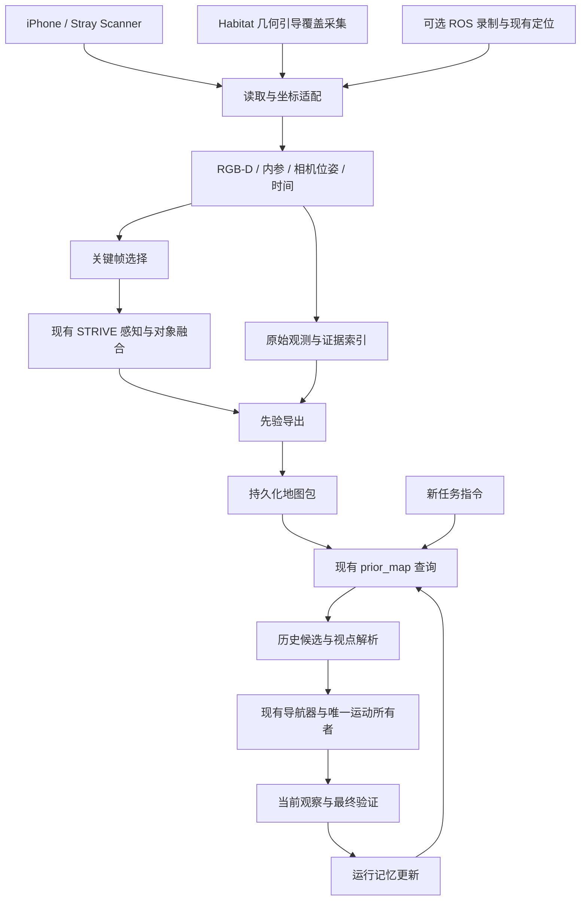

# STRIVE 轻量先验地图设计方案

更新日期：2026-11-01。状态：**基础链路已贯通，尚待可用性与实物验收。**

采集、建图、导出重载、检索已有实现；单个 chair 任务已完成同会话到达、当前取证、最终验证和 STOP。当前默认仍为原 STRIVE 融合。新的观察归属协调器保持实验入口，尚未通过质量门槛。

## 距离交付仍需完成的必要工作

此清单替代旧状态表及分散的“下一步”描述。第11节保留原设计阶段定义；历史实验与失败证据见 [实施记录](archive/prior_map_capture_progress.md)，不作为逐项重跑清单。

| 顺序 | 必须交付的结果 | 当前缺口 | 完成依据 |
| --- | --- | --- | --- |
| 1 | 可用于搜索的地图与证据 | 混合实例、检测误识别可能提供错误位置或证据；已有纠错协调器效果不足 | 冻结目标查询逐项核对正确位置、原始证据和可执行视点；保留原有有用对象。采用新融合时须通过已冻结质量门槛，未通过则维持实验状态 |
| 2 | 一致的取证与任务闭环 | 独立先验到达入口已绑定当前mask/深度并校正俯仰；正式ObjectNav入口仍走原验证链，尚需接入共享当前观察几何；复杂任务对应关系未验收 | 接近、取证、距离判断引用明确当前观察；普通类别任务重新识别当前目标，指定实例/属性任务验证对应约束；无法确认时保留未完成状态 |
| 3 | 固定任务集的仿真验收 | 已有独立chair闭环；三类普通目标的三组对照已完成9次有效运行，先验尚未带来收益；复杂任务切片尚未覆盖 | 固定地图、任务、起点与预算，覆盖普通目标、相似实例、属性消歧和历史目标当前不可见；对比无先验、对象先验、对象加证据，报告成功、路径、耗时与终止原因 |
| 4 | 真实手机数据生成同格式地图 | 导入器已有，真实输入尚未验收 | 一份实际 Stray Scanner 采集完成导入、尺度/位姿检查、建图、退出重载和查询；导出可追溯原始证据 |
| 5 | 实物已知初始化导航闭环 | 尚无实物端到端验收 | 明确手机地图到机器人定位坐标变换，现有运动所有者执行到达、当前取证、验证与停止；记录实际结果 |
| 6 | 可复现的交付入口与资源报告 | 命令与结果分散在诊断记录；成本验收不完整 | 收敛维护命令、配置、地图样例、验收回执与必要回归测试；报告采集/建图时间、峰值资源、存储、加载及在线耗时 |

**执行顺序（用户2026-11-01确认）：先完成1—3及6的仿真交付，再进行4—5的手机扫描与实物接入。当前不等待手机数据或机器人环境。**

### 完成边界

- **仿真交付**：完成1—3及6的仿真部分。正式报告SR/SPL时，需接通相应任务评估器；预探索设置单列，不混入标准未知环境成绩。
- **仿真与实物统一方案交付**：完成全部六项。不能用手机合成测试或仿真成功代替实物验收。
- **跨次自动重定位、多层泛化**：保持独立扩展待办；已知初始化和已验收区域是首版明确使用边界，不宣称支持尚未验证的范围。

### 从当前执行清单移除的工作

- 重跑已完成的19/298观察阈值排列、外观加权、强支持组直接拆分等探索；历史结果保留。
- 扩大DualMap消融、追求所有观察唯一归属或地图绝对精准。
- 为每个中间状态增加独立脚本、临时数据包与重复测试。
- 在可用性尚未验收时扩大场景和导航规模。

保留坐标/深度、身份与证据引用、暂缓隔离、局部重建、运动与完成条件的核心回归测试。临时实现只有被正式路径取代且确认无调用方后才删除；当前文档整理不删除源码或原始实验产物。

## 1. 设计决策

**实物用 iPhone 采集，仿真用现有 Habitat 采集；两者提供带位姿的 RGB-D，复用 STRIVE 感知、对象融合和导航，通过现有 `prior_map` 保存与查询先验。**

**首阶段交付“可靠观测＋几何诊断＋可重载预测地图与检索证据”，导航接入在地图质量通过后开展。** 仿真优先实现独立、几何引导的覆盖采集，baseline 巡视改造后移。协议先冻结，采集、融合、存储分别验收。优先减少新增依赖和重复实现，再通过实测决定是否优化建图计算量。

| 组成 | 本版选择 | 使用范围 |
| --- | --- | --- |
| 实物离线采集 | Stray Scanner，带 LiDAR 的 iPhone | RGB、深度、置信度、内参、相机位姿 |
| 备选手机输入 | Record3D | 需要其数据格式或 USB 流式输入时接入 |
| 仿真采集 | 维护中的 Habitat 环境＋独立覆盖采集器 | 连通区域、位置与视角显式规划；连续巡视后续对照 |
| 默认建图 | 现有 STRIVE 检测、分割与对象融合 | 对象级地图、已有房间信息与观察点 |
| 先验消费 | 现有 loader、memory、query 与策略接口 | 搜索上下文、排序；后续接历史视点 |
| 独立建图对照 | DualMap | 相同观测输入下比较质量、时间和资源 |
| 可选布局输入 | Apple RoomPlan | 房间结构和大型家具先验 |

HOV-SG、Hydra 和完整 OK-Robot 系统保留为技术参考。首版采用一个默认建图器和一个独立对照，不增加插件系统、第二套导航状态机或新的通用建图框架。

**“集成轻量”和“运行轻量”分别验收。** 手机输入减少采集与位姿获取的工程工作；现有检测器的计算成本仍需测量。手机负责采集，STRIVE/DualMap 语义处理运行在工作站。

## 2. 当前基础与待实现边界

本次改写核对了 `prior_map/contracts.py`、`policy_adapter.py`、`real_robot.py` 等接口。下表的“已有”表示源码中存在相应能力，不代表新地图流程已经端到端运行。

| 能力 | 当前基础 | 本版工作 |
| --- | --- | --- |
| 先验协议 | `PriorMapData`、`PriorObject`、`PriorRoom`、拓扑 | 继续使用 canonical JSON |
| 观测摘要 | `PriorObservationRecord` | 增加外部证据索引；摘要与完整观测分开 |
| 加载、查询、对齐 | `loaders.py`、`memory.py`、`query.py`、`alignment.py` | 复用并验证新产物 |
| 实物语义输入 | `backends/ros/scene.py` 与 `SemanticMapSnapshot` | 确认累计地图来源及字段完整性 |
| 仿真对象地图 | 当前 mapper 与 Habitat 适配 | 提取累计预测结果，隔离任务相关初始化 |
| 策略接入 | 先验排序和上下文；`ranking_only` | 第一阶段沿用；第二阶段解析历史视点 |
| 手机数据 | Stray Scanner 导入器及合成数据测试已实现 | 真实扫描的几何与重定位验收 |
| 历史实例导航 | 单目标chair同会话取证、真实最终验证与STOP闭环已完成 | 验收实例对应、复杂任务及官方指标 |
| 实物跨次定位 | 当前验收情况未确认 | 与地图生成分开验收 |

旧版布局生成命令、BEV 和接口说明保留在 [历史参考](archive/prior_map_legacy_reference.md)。现有实现受本版目标约束逐步迁移，文档更新本身不改变运行行为。

## 3. 数据流与职责



- 采集器记录观察事实、标定与位姿。
- 现有 mapper 负责对象关联和几何融合。
- 导出器负责协议转换、引用关系和文件落盘。
- 查询服务提供历史候选、排序与证据。
- 目标解析与导航服务产生当前可执行位置。
- 最终验证器使用当前证据判断任务完成。

历史对象可以支持前往已记录区域；它尚未进入当前视野时，也可以发起导航。运动目标由领域服务解析，执行仍经过现有运动所有者。历史类别和位置作为待核实信息，到达后以当前观察更新。

## 4. 实物采集：iPhone 离线扫描

### 4.1 默认使用 Stray Scanner

采集设备需具有应用支持的 LiDAR 能力，具体机型、应用版本与导出字段在首次采集时记录。首版离线文件传输便于复放和比较，不要求建立手机实时 ROS 链路。

官方格式包含：

```text
scan/
  rgb.mp4
  depth/                 # 16-bit PNG，官方格式单位为毫米
  confidence/            # 深度置信度
  odometry.csv           # 帧号、时间、位置、四元数；新格式含逐帧内参
  camera_matrix.csv      # 兼容用途内参
  imu.csv
```

读取器按实际文件头识别版本。使用逐帧内参时，明确其对应分辨率；旧数据只提供会话内参时，记录这一来源。RGB 与深度尺寸不同时，需要按采集器标定约定完成对应，不能直接共用未缩放的像素坐标。

原始导出保留不变，读取器负责毫米到米、位姿方向和坐标轴转换。首个样本通过投影可视化确认约定后，固定该格式版本的转换。

来源：[Stray Scanner](https://github.com/strayrobots/scanner)、[官方格式](https://github.com/strayrobots/scanner/blob/main/docs/format.md)。

当前导入器实现、上游版本及测试边界见 [Stray Scanner 适配说明](prior_map_stray_scanner.md)。真实手机几何验收仍未完成。

### 4.2 采集流程

1. 从明确的起始区域扫描，覆盖通道、地面和待使用区域。
2. 对重要物体保留正面及不同方向观察，减少模糊与遮挡。
3. 保留完整原始记录，停止后传至工作站。
4. 先检查深度尺度、位姿和多帧投影，再运行语义建图。
5. 保存地图及采集范围，随后使用新指令检验检索与导航。

手机相机轨迹记录“人在哪里拍摄”。导航观察点需要结合地面、底盘尺寸和当前可达性产生，手持相机高度不能直接作为底盘目标高度。

### 4.3 Record3D 与机器人原生采集

Record3D 作为备选读取源，按需要支持离线 `.r3d` 或 USB RGB-D 流。DualMap 已有对应运行入口，适合独立测试。首版先完成 Stray Scanner 一种手机输入，避免同时维护多个未验收适配器。

机器人原生模式继续使用现有相机、定位、检测与 SysNav 语义地图。若最终 `SemanticMapSnapshot` 仅含局部对象，导出应访问现有累计地图或已有对象更新记录；最后一帧的可见对象不能代表完整巡视结果。确定来源后复用同一导出函数，保留各输入的来源标识。

## 5. 仿真采集：独立几何引导覆盖，连续巡视后移

### 5.1 采集目标和信息边界

Habitat 可提供可通行点、连通分量、路径查询与指定姿态的 RGB-D 渲染。高质量语义记忆仍需经过采集规划、投影和实例融合。首阶段用独立采集器隔离 baseline 探索、任务初始化和控制器失败的影响。

允许采集器使用 NavMesh 与仿真相机位姿，manifest 明确标记几何辅助和 GT 位姿。预测建图输入仅包含实际渲染的 RGB-D、标定和位姿；episode goals、语义实例标注和成功指标保留在独立评测侧。采集用 NavMesh 数据留在采集诊断产物中。

### 5.2 区域、位置与视角生成

1. 枚举 NavMesh 连通区域，记录 island、面积、高度范围、纳入状态及排除原因。楼层与连通分量分别表示，一个连通分量可以跨楼层。
2. 在选定区域生成有空间间隔的候选点，检查贴近障碍物、采样重复和区域空缺。保留实际候选清单与种子。
3. 给候选点配置相机高度和多方向视角；先覆盖水平方向，再根据观察缺口补充俯仰或位置。
4. 渲染并检查有效深度、视野与跨帧重叠。NavMesh 可站立只证明地面位置可用，相机位姿需另做检查。
5. 根据位置与观察覆盖补采，固定预算内仍存在的缺口写入报告。

水平视角间隔可按下式设计初值：

\[
\Delta\theta\leq(1-\rho)\,\mathrm{HFOV},
\]

其中 \(\rho\) 为期望角度重叠比例；真实图像重叠受遮挡与深度影响，以渲染检查为准。采样间距、高度和俯仰配置先在单房间诊断中确定，再冻结用于扩大实验。

### 5.3 两种明确采集模式

| 模式 | 行为 | 验收范围 |
| --- | --- | --- |
| `coverage_scan` | 在检查过的相机姿态直接渲染，按区域和空间邻近顺序组织 | 首阶段数据构建；不表示机器人真实执行了路线 |
| `continuous_walk` | 连通区域内沿路线实际移动、途中采集 | 后续连续性、在线建图及 baseline 探索对照 |

互不连通区域按不同采集段记录。离散视图保留重叠和分组，依赖连续跟踪的建图模块单独验证适用性。直接设定姿态不能伪造动作成功或连续运动记录。

baseline 的当前房间优先、路径距离选点和房间切换在 P7 接入。届时再分离目标类别、`distance_to_goal`、任务停止与建图初始化，不将整个 ObjectNav 生命周期作为首阶段采集依赖。

### 5.4 覆盖检查与停止

对固定的区域检查点集 \(Q\) 与已采集位置集 \(V\)，报告：

\[
C_{\mathrm{position}}(r)=\frac{1}{|Q|}\sum_{q\in Q}
\mathbf{1}\!\left[\min_{v\in V}d_{\mathrm{nav}}(q,v)\leq r\right].
\]

检查点分布、区域分母、距离阈值和各 island 分项均保存；不连通距离按不可覆盖处理。这个指标表示位置覆盖，物体是否看清还需观察覆盖诊断。

观察诊断记录有效深度比例、观察方向、多视角重叠、新增可见几何以及对象证据的像素面积、距离和遮挡。GT 物体可见率或完整 mesh 表面覆盖只用于独立评测，并记录其评测范围。

停止条件为达到冻结的覆盖要求或预算耗尽。后者标记 `budget_exhausted` 并输出缺口；“执行结束”与“覆盖达标”是不同状态。

### 5.5 无损观测与重放

采集数据单独保存：

```text
captures/<scene_id>/<capture_id>/
  manifest.json
  regions.json             # 区域范围与纳入原因
  poses.jsonl              # 候选及实际采集姿态、采集段
  frames.jsonl             # 帧、传感器位姿、内参、文件引用
  actions.jsonl            # continuous_walk 的实际动作
  observation_groups.jsonl # 全景或多视角分组及完整性
  coverage.json            # 位置/观察指标与未覆盖区域
  rgb/                     # 无损 PNG
  depth/                   # float32 NPY，米制深度
```

原始观察在深度裁剪、图像拼接和展示转换前记录；8-bit 深度 JPG 仅作为预览。初始帧只写一次，动作后帧与实际传感器位姿一一对应。全景分组引用原始帧，预算导致的残缺分组按事实记录。

采集 manifest 保存场景资产、镜像与代码版本、传感器配置、深度定义、采集模式、位姿来源、随机种子、预算、完成状态和结束原因。仿真步骤始终记录，时间仅按明确的仿真时间定义填写。

场景版本与坐标一致时，不同任务可复用地图；HM3D 与 OVON 的复用需核对实际场景配置。既有目标/语义标注构图脚本保留为 oracle 对照，不进入预测观测建图主链路。

## 6. 最小观测与空间模型

每条逻辑观测为：

\[
o_t=(I_t,D_t,C_t,K_t,T^M_{C_t},t),
\]

**统一地图坐标：米制、右手系、Z 轴向上、房间二维边界位于 XY 平面；相机光学坐标为 X 向右、Y 向下、Z 向前。** 原始记录保留来源坐标，适配器转换后输出统一协议。矩阵使用行优先序列化、左乘列向量，明确 `camera_to_map`；JSON 中的四元数若出现，固定 `xyzw`。

Habitat 世界坐标、mapper 局部坐标、floorplan 和 ROS 坐标在适配边界转换。现有字段与代码不会因文档声明而自动迁移，需通过已知点投影和跨起点对齐测试。仿真 NavMesh 与实物定位/避障地图继续归各执行后端管理。

其中 \(C_t\) 为可选深度置信度，\(T^M_{C_t}\) 将相机坐标转换到地图坐标。协议明确深度单位、深度定义、四元数顺序、相机轴、世界轴和图像尺寸。

若深度表示相机光轴方向距离，像素投影为：

\[
p_M=T^M_C\begin{bmatrix}D(u,v)K^{-1}[u,v,1]^\top\\1\end{bmatrix}.
\]

射线距离与归一化深度先按输入定义转换。机器人输入由底盘位姿和相机外参得到：

\[
T^M_C=T^M_B T^B_C.
\]

对象证据关联为：

\[
(map\_id,object\_uid)\leftrightarrow observation\_id
\leftrightarrow(I,D,mask,K,T^M_C,t).
\]

对象身份沿用现有融合逻辑，并在本轮固定观察上验收，类别、几何与来源分别保存。历史对象 ID 与运行时跟踪 ID 建立显式对应。类别相同或 UID 字符串相同不足以证明跨地图实例相同。

## 7. 轻量建图与存储

### 7.1 复用范围

优先调用现有检测、分割、对象融合与查询。实施前检查 mapper 对 episode、任务词表、目标选择和在线推进状态的依赖，仅提取建图所需调用边界。本文不假设现有 Habitat mapper 已能直接接收手机记录。

首版基于固定通用词表构图时，manifest 记录词表及版本；地图覆盖能力受词表和巡视视野限制。原始关键帧支持后续按需补充识别，开放词汇查询的能力不等同于任意对象都已入图。

### 7.2 关键帧与证据

复用已有关键帧机制；若缺少机制，首先采用位移或转角触发，并检查模糊及有效深度。阈值通过同一小样本确定并写入配置，不在方案中规定未经验证的固定数值。

每个实例保存少量清晰、视角有差异的证据。首版采用稀疏对象记录与引用；全量点云作为已有建图器的可选附属输出。关系、房间信息优先保存已有结果，按任务需求补充查询。

原始扫描与运行时地图包分开保存。验收同时报告地图大小和完整采集存储，避免把外部图像存储从总成本中漏掉。

当前已实现独立证据子集导出：保留每个预测标签的样本、同帧分离 mask 复核对，再补充相机位置差异。实测包体积下降 STRIVE 3.03%、DualMap 36.15%；STRIVE 丢失一项跨帧 GT 冲突证据，故仍为实验路径，完整包保留。证据数下降、存储下降和地图质量改善分别验收；详见采集记录的“证据精简”章节。

### 7.3 统一地图包最小协议（设计冻结，基础读写已实现）

```text
prior_maps/<map_id>/
  manifest.json
  prior_map.json         # 现有 PriorMapData canonical JSON
  observations.jsonl     # 证据索引、标定与 camera_to_map
  viewpoints.json        # 两种明确类型的视点
  evidence/              # 少量精选图像、mask、必要深度
  features/              # 可选数组与模型身份
  geometry/              # 可选几何；不作为启动必需项
```

深度证据支持 `.npy` 与无损 `.npy.gz`，共同经 `load_depth` 读取，保持 float32、米制 optical-Z 与标定不变。压缩导出在 manifest 声明 `depth_storage.encoding=npy_gzip`，附源索引、编码文件与解码文件哈希回执。仅改变存储编码时保留 map_revision；证据删选与几何更新另行变更 revision。旧版直接使用 `np.load` 的消费者需更新后读取压缩包。

原始 capture 用于重建与离线复放；运行时按需加载 map，查询无需加载完整 RGB-D 或点云。所选证据复制到地图包或通过显式资源索引定位，避免依赖未声明的机器绝对路径。移动地图包后的引用解析纳入测试。

| 协议部分 | 冻结要求 |
| --- | --- |
| manifest | `schema_version`、`map_id`、`map_revision`、坐标约定、`source`、`capabilities`、`artifacts`；构建配置与采集引用 |
| 地图核心 | 保留 `PriorMapData` 的 scene/frame、对象、房间、拓扑和 metadata 结构 |
| 对象身份 | 新建地图分配 UUID map_id；`(map_id, object_uid)` 唯一；revision 标识地图版本；运行时 tracker ID 单独关联 |
| 对象属性 | 类别、位置、置信度、来源和可选房间；几何、证据及特征使用明确引用 |
| 证据 | observation ID、图像引用、可选深度/mask、内参、camera_to_map、时间或帧序号、关联对象 |
| 历史拍摄姿态 | `kind=observation_pose`：传感器当时的位置与朝向 |
| 导航观察点 | `kind=navigation_viewpoint`：领域服务处理后的候选，记录来源观察、适用底盘和可达性检查状态/版本 |

`scene_id` 标识环境，`map_id` 标识一次独立构建的地图；两者不由保存目录推导。STRIVE 与 DualMap 新导出均生成 UUID，重载、搬移、证据子集和无损压缩保留 map_id；证据子集另增 revision。已有以目录命名的实验包保留原值，其同名 map_id 不可用于跨包身份判别，读取旧记录时需同时绑定具体包与源回执。

`exact=True` 表示记录指向一个具体实例，类别正确性与任务满足另由证据判断。空房间列表表示未提供房间结构，不能推断为场景没有房间。历史可达性检查不替代执行时的当前可达性判断。

首版 `capabilities` 声明实际可用的对象位置、视觉证据、房间、视点与特征。查询明确返回缺失能力；可选数据按需加载。小型来源扩展写入约定的 metadata，跨模块依赖的字段在协议升级时正式定义。

现有 loader 的 dataclass 构造不自动接受任意新增顶层字段。保留 `prior_map.json` 兼容结构，用薄地图包入口验证版本、读取索引和调用原 loader；不把外部研究仓库的 Python 对象作为持久化格式。特征引用附编码器身份、维度与归一化约定。

视点不能由拍摄高度直接转换成运动目标。底盘姿态、地面、可达性由现有导航服务解析。拓扑边保存已有明确关系，空间距离近不足以建立通行连接。

## 8. 共享地图、区域决策与导航闭环（2026-11-01更新）

**设计目标：先验地图成为 LVLM 与人类共同读取、提出修订的环境状态。区域级决策使用环境布局、房间语义、历史证据和运行轨迹；frontier 排序负责落实当前区域内的探索。** 本节为待实现设计，已有实现与实验事实见8.1；本次只更新文档，保持现有导航代码。

### 8.1 当前实现及全部对照结果

当前链路是历史对象检索→BEV/候选上下文→局部frontier偏置→原导航器→当前验证。wcojb4TFT35共享地图含200个预测对象、80帧采集；`rooms=[]`、`topology_edges=[]`。原始观察另存于`observations.jsonl`，核心JSON中的空观察列表不代表没有视觉证据。它尚不具备本节设计的房间布局推理闭环。TV、sofa、chair使用同一地图的不同查询。

| 任务 | 无先验：成功/SPL/步数/路程m | 对象先验 | 对象加历史图像 |
| --- | --- | --- | --- |
| TV | 1 / 0.5817 / 189 / 19.72 | 1 / 0.4460 / 280 / 25.67 | 1 / 0.3801 / 298 / 30.15 |
| sofa | 0 / 0 / 35 / 1.46 | 0 / 0 / 35 / 1.46 | 0 / 0 / 35 / 1.46 |
| chair | 1 / 0.5096 / 74 / 7.66 | 1 / 0.5096 / 74 / 7.66 | 1 / 0.5096 / 74 / 7.66 |
| 成功率 / 平均SPL | 2/3 / 0.3638 | 2/3 / 0.3185 | 2/3 / 0.2965 |

完整结果：[comparison_summary.json](../outputs/prior_evaluation/wcojb-three-arm-006/comparison_summary.json)。两组先验回执均complete、returncode=0，耗时分别934.9和967.2秒（整组含启动及产物写入）。旧001—005版本的协议失败和主动停止是调试尝试，不增加独立样本数。baseline保留001/002/003的已完成任务，期间provider协议发生变化；因此baseline与先验差异属于工程回归证据，不能全部归因于地图。两个先验组使用相同006冻结源码，样本量仍只有三个任务。

TV模型调用数12→24→27。错误monitor先验对应的历史框存在monitor/mirror类别冲突，外观更支持镜面结构；未读取该物体GT类别，不能把外观判断写成GT。其位置与数据集合法TV目标明显分离。模型初期两次仍沿该monitor候选选点，加入历史图片未纠正这一早期判断。融合类别竞争信息在导出时收敛为单标签，检索及选图继续强化该标签，是需要处理的信息损失。这里的`exact=True`仅表示具体实例身份，不表示类别正确。

sofa三组同样误完成：内部预测对象距离约0.542m，官方目标距离4.581m。最近融合点投影在当前画面内，深度残差约0.009m；已有证据不支持把本例归因于不可见旧点。语义误接受需要单独解决。当前几何与mask绑定的一致性仍是正式链路缺口，但改善几何不能保证消除语义误识别。

### 本轮实现进度：仿真共享地图

**当前执行清单见[待做清单](prior_map_todo_checklist.md)。** 已接入`shared_map_<step>.json`，统一保存地图、版本、定位来源、朝向、实际轨迹、运行时区域和选区结果；同一状态生成BEV。区域候选复用`Room_node.room_id`及现有NavMesh路径代价，单候选直接执行，多候选使用已有LVLM选择器；选中区域内恢复baseline距离排序。

**本轮边界：** 区域来自已有在线划分，未补建离线房间边界；缺失类型保持unknown。仿真采用Habitat已知位姿与既有alignment配置，自动重定位、运行中人工校准接口、实物接入继续待做。必要回归46项已通过；冻结TV运行成功，189步、19.7171m、SPL 0.5817418、模型12次，与保留baseline核心指标一致。该例只有一个可执行区域，多区域模型决策尚未验收。终态地图补充发布已接入并通过契约检查，待实际入口验证。

### 几何区域构建与组合入口

**仿真几何先验模式：** 维护脚本新增`--geometry_only --floor_height <Habitat y>`，复用NavMesh采样、统一地图协议和BEV输出。宽区域侵蚀种子沿自由空间扩展，区域标签保持unknown；`--region_clearance`为额外种子侵蚀半径，默认0.35m，不代表机器人碰撞半径。当前wcojb楼层生成9个几何区域，真实导航收益仍待验收。

```bash
STRIVE_DATA_ROOT=/path/to/data bash docker/run_hm3d_floorplan_layout.sh \
  /workspace/data/scene_datasets/hm3d_v0.2/val/00802-wcojb4TFT35 \
  --geometry_only --floor_height 0.01637 --topdown_resolution 0.1 \
  --scene_id wcojb4TFT35.basis --output outputs/prior_layouts/wcojb-navigation-regions/layout.json
```

同时导出标准`prior_map.json`。导航入口使用`--prior_map_path <对象包> --prior_map_layout <区域prior_map.json>`；两者必须具有相同scene_id和frame_id，区域文件哈希随运行冻结。采用完整NavMesh几何的实验单列为已知几何先验，手机模式仍需从实际采集生成布局。

**区域语义输入已接入：** 通过历史相机位置关联区域，汇总“从该区域观察到”的预测类别。计数为不同帧数，保留类别冲突、示例观察ID和索引哈希；不将家具中心强行绑定到可通行地面，也不把计数解释为独立对象数量或概率。固定先验区域ID在新frontier出现时保持当前子目标，耗尽后重新选择。002已证明多区域执行及终态轨迹闭环，但效率下降；003正在验证上述语义与调度修正。

### 8.2 一份规范状态，三种同步表达

\[
\mathcal M_t=(G_{\rm geom},G_{\rm region},\mathcal O,\mathcal E,\Delta_t),\qquad
\mathcal V_t=\operatorname{Render}(\mathcal M_t,\hat T_t,\Sigma_t,\tau_{0:t},q_t).
\]

几何层保存已知自由空间/障碍及来源；区域层保存区域边界、入口、通行关系和房间语义；对象层保存实例、候选类别、证据引用；运行覆盖层\(\Delta_t\)保存访问、冲突、当前观测及人工修订。\(q_t\)为任务进度，\(\tau\)为轨迹。地图事实以结构化状态为准，图像只是该状态的可读投影。

| 表达 | 内容 | 用途 |
| --- | --- | --- |
| 全局BEV/SVG | 比例尺、坐标轴、房间/区域ID、门口、目标候选、轨迹、朝向、不确定范围 | 人类查看和LVLM全局推理 |
| 当前区域局部图与证据 | 可达候选ID、局部障碍、当前图像、必要的历史多视角及类别冲突 | 精细选点与目标复核 |
| 结构化JSON/摘要 | 相同ID与revision、语义状态、证据来源、访问结果、候选实际路径代价 | 确定性查询、工具执行及审计 |

三种表达由同一快照生成，并绑定`map_id/revision/alignment_revision`。LVLM输出区域或候选ID及可核验修改提案；领域代码提交状态更新并重绘。避免让模型凭图像自行重画墙体或直接维护米制坐标。

区域边界与房间类型分别处理。自由空间和门口来自已有几何/房间划分服务；房间类型可由LVLM结合多视角提出，保留`unknown/inferred/confirmed`及证据。多个区域可属于同一房间，开放空间也可含多个功能区。缺少边界时先维护区域节点，逐步补齐关系。对象散点无法单独证明墙、门或通行性。Habitat采集使用NavMesh时记录几何先验设置；GT语义房间和目标位置仅用于离线评价，不进入运行输入。

### 8.3 维护闭环与人工参与

```text
先验包 + 实时观测 + 定位 + 人工修订
  → 统一快照与版本
  → 全局地图 / 局部证据 / 结构化上下文
  → LVLM选择区域、候选或提出语义修订
  → Harness校验引用、权限和版本，提交子目标
  → 原规划器 + 唯一运动所有者
  → 到达/阻塞/当前验证事件
  → 更新访问、证据、定位和轨迹 → 重新发布快照
```

首版只增加必要事件：`SetInitialPose`、`CorrectAlignment`、`SetRoomLabel`、`ReviewPriorObject`、`SelectRegion`。名称表示设计接口，不表示已完成工具。每次修改记录来源、人/模型、依据、旧值、新值和revision；人工语义修订同样保留原观测。

LVLM可提出“此对象更像镜子”“此区域可能是客厅”，有新证据时允许重评。某一UID被拒绝只影响绑定任务、实例版本和证据的结论；一次未看到目标不能永久删除对象。否定证据需要已执行视点、视野/遮挡与观察覆盖支持。正式目标完成仍由当前取证和任务reducer判定。

Agent只在区域耗尽、证据冲突、目标变化、定位修正、导航阻塞等明确事件介入。普通局部推进继续复用baseline。模型请求失败明确报错；几何先验不可用时按显式能力状态使用baseline局部策略，两者分别记录。

### 8.4 全局区域选择：先决定去哪里，再决定区域内怎么走

令\(\mathcal R_t\)为当前可规划的区域集合，\(\mathcal F(r)\)为区域内可执行frontier。跨区域子目标经入口/通行图交给原规划器，避免始终被当前房间候选集合限制。已有历史视点须先解析为当前可达底盘位姿，不能直接使用相机位置。

若区域目标概率\(p_r\)已校准、搜索代价\(C_r>0\)、目标互斥且检查可靠，两区顺序比较为：

\[
E[C_{a\to b}]=C_a+(1-p_a)C_b,\qquad
 a\prec b\iff\frac{p_a}{C_a}>\frac{p_b}{C_b}.
\]

该关系解释“目标可能性与搜索成本共同决定顺序”，实际多目标、转移代价和检测不完备会破坏这些简化条件。首版不把LVLM置信度当校准概率。由LVLM在提供真实路径代价的有限区域选项中给出语义排序，领域层保留其依据与成本；后续确有数据再校准概率和搜索预算。

更新区域决定以当前子目标完成、证据变化或明显效用改善为触发，保持已提交子目标的执行稳定性。暂不同时新增信息增益、外观、访问次数等多个可调权重。

### 8.5 当前frontier公式的准确含义与问题

现有实现先选平面最近对象，然后计算先验增量：

\[
j^*(f)=\arg\min_j\|f-p_j\|_2,\qquad
 g(f)=c_{\rm align}\left[\frac{0.7}{1+d_E(f,p_{j^*})}+0.25R_r+0.25s_{j^*}+v_r\right].
\]

\(R_r\)为房间分数正向变换，\(s_j\)为概念相关度，\(v_r\)为房间访问/耗尽调整。现有公式隐含1m距离尺度；分数不是目标概率，也没有统一保证落在[0,1]。当前地图无房间节点，相关结构不能发挥预期作用。

\[
f^*=\arg\min_{f\in\mathcal F(r_t)}\left[d_{\rm nav}(x,f)-\lambda\max\{g(f),\mathbf1[f=f_{\rm Agent}]\}\right],\quad\lambda=1\text{m（当前默认）}.
\]

问题包括：先按最近距离决定对象，使近处错误候选压过远处正确候选；欧氏邻近跨墙也可能成立；Agent选中被赋值为1，语义证据强弱未体现在该项；错误结论缺少绑定历史候选的反馈撤销；当前房间候选集合难以表达跨房间目标。\(\lambda\)调整只改变局部排序力度，不能解决这些结构问题。

### 8.6 最小局部改进与参数解释（提案，未运行）

使用已选区域内的可执行视点代替对象中心衡量接近代价。首版保留一个距离偏置参数：

\[
 b_t(f)=\max_{j\in\mathcal J(r)}\frac{q_{j,t}s_{j,t}}{1+d_{\rm nav}(f,v_j)/\ell},\quad
 f^*=\arg\min_{f\in\mathcal F(r)}\{d_{\rm nav}(x,f)-\lambda b_t(f)\}.
\]

\(v_j\)是当前可达、具观察意义的历史候选视点；\(\ell\)是显式的距离尺度，首轮固定1m以对照旧尺度；\(s\in[0,1]\)为任务相关度；\(q\in[0,1]\)为证据及定位的可用程度，属于有来源的工程权重而非未经校准的联合概率。冲突未解或定位不足时，该候选不提供几何奖励。无有效候选时\(b=0\)，复用baseline排序。可达性按当前地图确定；未知代价保持未知，不能将直线距离标作路径距离。

模型负责区域/语义决策，移除“选中的frontier自动获得满分”的重复奖励。上述改法改变候选选择范围与距离依据，必须与只调\(\lambda\)区分验证。

当\(0\le b\le1\)时，选中frontier相对本轮最近frontier的额外接近距离满足：

\[
d_{\rm nav}(x,f^*)-d_{\rm nav}(x,f_{\rm nearest})
\le\lambda\,[b(f^*)-b(f_{\rm nearest})]\le\lambda.
\]

因此\(\lambda\)表示单次局部决定愿意额外支付的最多米数；它不限制整次episode总绕行，连续错误仍会累积。需要结合候选复核、区域访问反馈和子目标预算，而不是只缩小权重。

参数计划：先冻结无偏置\(\lambda=0\)作为对照，再在独立校准任务比较\(\{0.5,1,2\}\)m；固定\(\ell\)及其他规则，记录首次分叉、错误候选吸引路程、区域切换、SR/SPL、调用数。当前三个任务用于诊断，保留新场景作验证。初始定位误差实验单列，避免混入语义权重实验。以上只是后续计划，本轮不启动。

### 8.7 最大复用现有代码的落点与必要验收

| 现有模块 | 后续必要调整 |
| --- | --- |
| `capture_builder.py`、`observations.py` | 保留原始证据；导出可用类别竞争信息；连接已有区域/房间几何结果 |
| `memory.py`、`alignment.py` | 统一运行覆盖层、定位对齐revision和人工事件，复用现有状态管理 |
| `visualizer.py` | 同一快照渲染全局/局部图、轨迹、朝向、人工校准结果和未确认区域 |
| `query.py`、`query_binding.py` | 返回区域、证据冲突、可执行视点及真实路径成本；历史对象拒绝反馈闭环 |
| `high_level_selector.py`、`harness/runtime.py` | 事件触发的区域/语义选择；读取同版本图文；保留模型失败原始回执 |
| `exploration_policy.py`、既有motion服务 | 执行区域子目标，区域内复用baseline；一个运动所有者 |
| 当前验证共享入口 | 将实例身份、当前mask、距离和任务满足关联到同份当前证据 |

先验包继续轻量JSON+图像/深度引用，区域和轨迹为小型增量，不增加完整稠密语言特征场或新的SLAM框架。现有schema变更需要显式版本适配，新增字段不能直接写入不兼容dataclass。

最少验收：图文候选ID/revision一致；人工初始位置及修正可重放；跨区域目标有可执行入口；未知房间不被画成确定事实；当前TV冲突可显示并写回候选状态；完成仍检查当前目标。此后才用固定导航任务评估收益。实物采集与运行继续后置。

## 9. 统一定位、人工初始化与运行轨迹

地图坐标为\(M\)，里程计坐标为\(O\)，底盘为\(B\)：

\[
T^M_B(t)=T^M_O\,T^O_B(t),\qquad
\tau_{0:t}=\{\operatorname{translation}(T^M_B(k))\}_{k=0}^{t}.
\]

**里程计/SLAM维护连续位姿；LVLM识别房间和地标、提出重定位候选；几何模块确认坐标变换。** 只积分命令动作无法表达碰撞和打滑，轨迹应来自实际状态反馈。仿真已知位姿作为首版定位来源并明确披露；实物采用既有定位链。两者输出统一位姿、时间戳、来源及可用的不确定性。

人工给定时刻\(t_0\)的完整平面位姿（地图点与朝向）后：

\[
T^M_O=T^M_{B,\rm human}(t_0)\big(T^O_B(t_0)\big)^{-1}.
\]

在重力、尺度、楼层已知的SE(2)问题中，一个点只约束平移，方向仍需人工指定或额外地标约束；两个不同位置的对应点可求平面旋转和平移，但间距过小会放大误差。三维场景另需非退化几何约束。界面应让人“点位置＋拖朝向”，并显示当前楼层及定位来源。

自动初始化先用历史图像进行位置候选检索，再用RGB-D/特征对应的PnP或点云配准作几何验证；这是扩展能力，当前没有验收。LVLM猜测“在客厅”只能初始化区域假设，不能伪装成精确米制位姿。若协方差可用，显示位置椭圆和朝向范围；其阈值应与通道净空和候选间距匹配，不凭固定小数声称定位可靠。

人工运行中校准生成`CorrectAlignment`：记录时间、坐标系、修订前后变换和来源；若影响正在执行的目标，先经运动所有者取消/保持并取得回执，再重新投影目标和规划。轨迹从保留的里程计轨迹重新投影，所有关联缓存按alignment_revision失效。原始历史观察及其采集坐标保持可追溯，不逐对象任意拖动坐标。SLAM回环改变历史关键帧几何时，按更新位姿重建相应产物，这是另一种地图revision。

手机扫描坐标与机器人地图对齐复用同一机制。已知初始化优先验收；手机原始数据及实物闭环在仿真交付后接入。

## 10. DualMap 对照与 RoomPlan 布局输入

### 10.1 DualMap：独立对照

官方提供 Record3D、离线数据、ROS 和 Habitat 相关入口，以及可查询的 iPhone/Replica 示例地图。先验证示例重载与查询，再将同一采集转换为其实际支持格式。

比较时固定采集、帧子集和查询集合，分别记录模型配置。分别报告输出对象、证据和地图资源；适配输出到 STRIVE 后，导航比较使用同一执行后端。

固定词表也是实验输入。12 类词表保留为早期工程对照；通用先验建图进一步验证任务无关的室内词表，避免只保存导航目标类别。上游已有 `gpt_indoor_general.txt` 包含 100 个具体概念和末尾 unknown 状态项。共享检测词表应保存具体概念，DualMap 适配器按其协议补充末尾 unknown，避免未分类 mask 被错误编码为最后一个真实类别。保持多词类别完整，禁止按场景标注补词。STRIVE 构建入口支持 `--classes-file`（一行一个概念），同时保留 `--classes`；两者互斥。实际类别列表写入构建记录，跨建图器对照先核对具体概念列表及顺序，再核对各自的状态项。

点采样参数随输入分辨率验证。当前 320×240 连续采集上，DualMap 的 4% 与 20% 采样消融已证明关联数量有明显差异；20% 仍为实验配置。类别稳定性、实例对应和地图覆盖分别验收，样本内正确的四个实例不能代替全场景质量证明。详细证据见实施记录。

DualMap 的速度收益、峰值显存、对象拆分与合并质量以本机测量为准。只有对照体现实际收益，再决定替换局部建图模块。

参考：[代码](https://github.com/Eku127/DualMap)、[手机入口](https://github.com/Eku127/DualMap/blob/main/resources/doc/app_runner_record_3d.md)、[离线地图格式](https://github.com/Eku127/DualMap/blob/main/resources/doc/app_offline_query.md)。

### 10.2 RoomPlan：可选布局来源

需要快速获得墙、门、房间结构和大型家具时，可将 `CapturedRoom` 结构化结果适配为布局先验。其支持类别与参数化几何服务于布局需求；细粒度开放词汇对象与视觉证据由 RGB-D 路线提供。

RoomPlan 为 Apple 平台框架，Habitat 通过其他来源生成同一先验协议。来自不同扫描会话的 RoomPlan 与 RGB-D 结果需显式对齐。

参考：[RoomPlan](https://developer.apple.com/documentation/roomplan)、[多房间及结构化导出](https://developer.apple.com/videos/play/wwdc2023/10192/)。

## 11. 实施顺序与最小修改范围

| 阶段 | 工作 | 修改边界 | 进入下一阶段的证据 |
| --- | --- | --- | --- |
| P1 | 冻结最小地图协议与当前接口核对 | contracts/loaders 的兼容边界、样例包 | 坐标、身份、证据、两种视点可验证 |
| P2 | 独立 Habitat 覆盖采集器 | 薄场景入口、区域/姿态生成、观测 writer | 区域清单、姿态、原始 RGB-D 和采集报告 |
| P3 | 单房间几何诊断 | 复放与投影检查 | 深度、位姿及多视角重合检查通过 |
| P4 | 接现有对象融合 | 最小建图调用边界、全景分组 | 固定输入上实例关联与证据可追溯 |
| P5 | 导出、退出、重载与检索 | 共享导出及薄地图包 loader | ID、位置、引用稳定；检索证据正确；本阶段不启动导航 |
| P6 | 多房间、多层扩展 | 采集配置与报告 | 分区域覆盖缺口、质量及资源成本 |
| P7 | 连续路线与 baseline 探索对照 | 现有运行入口及任务无关初始化 | 相同场景的采集过程差异分析 |
| P8 | 新指令使用历史地图导航 | 历史视点解析、现有运动所有者 | 实际到达、当前取证和完成判断 |

手机接入复用 P1 协议，在 HM3D 单房间链路验证后适配一种手机格式。DualMap 在 P4/P5 固定输入形成后独立对照；实物初始化与导航在对应链路通过后验收。

候选代码位置：`backends/habitat/capture.py` 负责采集，`prior_map/observations.py` 提供读写函数，`prior_map/exporter.py` 转换预测对象。薄 CLI 与 launcher 使用维护中的镜像；纯采集检查场景及所需 NavMesh，融合阶段再检查检测权重。文件名在实施时按已有结构收敛，不创建一次性抽象。

先审计 mapper 中几何融合与 `env.sim` 路径查询的边界。现有快照缺少的房间或证据按来源补充；不模拟假环境来满足离线融合的导航依赖。内部协议直接使用；错误带帧号、路径和阶段暴露，核心数学写入对应注释。代码实现与实测结果分别交付。

## 12. 验证方案

### 12.1 首轮最小对照与根因判别

历史失败的具体根因尚未由对应记录确认。先保存代码版本、输入清单、配置和输出；分开检查位置覆盖、视觉覆盖、投影、实例融合及导出检索。增加帧数只能验证观察不足假设，不能修复坐标错误。

| 对照 | 固定什么 | 只改变什么 | 判断什么 |
| --- | --- | --- | --- |
| 单帧与多帧投影 | 深度和位姿约定 | 帧数量 | 单帧已错还是跨帧错位 |
| 少量视图与补充视图 | 建图器及配置 | 采集覆盖 | 同一目标是否因观察增加而恢复 |
| STRIVE 与 DualMap | 同一观测集合、查询集合 | 建图器及其明确配置 | 实例融合差异与资源成本 |
| 离散扫描与连续路线 | 场景、传感器、建图配置 | 采集过程 | 连续性与探索造成的影响 |

投影错误时先处理空间链路；投影正确而实例拆分/合并错误时检查融合。补充视图后仍无改进，不将结果归因为覆盖不足。DualMap 对照能比较系统差异，不能单凭结果把收益归因于某一个子模块。离散与连续对照分别报告视图数量和分布，需要隔离纯顺序影响时再固定相同帧集合重放。

首个房间冻结检查对象、输入、误差度量与通过条件后运行；阈值由尺度、传感器配置和任务要求确定。结果不足以区分假设时标记未确定，保留原始失败产物。

### 12.2 数据与空间验证

- 抽取可辨认的物体，检查 RGB 区域、深度投影与三维实例共同空间依据。
- 验证毫米/米、四元数、相机外参及分辨率转换。
- 用实际尺度或仿真已知尺度检查误差；多视角检查重影、漏检、拆分和错误合并。
- 保存、退出进程、重载，核对对象身份、位置、证据引用和版本。
- 单独检查历史观察点到导航目标的高度、坐标与可达性处理。

### 12.3 后期任务验证（P8）

使用固定巡视记录和独立的新指令。比较无先验、预测对象先验、预测对象加证据；布局先验和 oracle 信息另列。测试需覆盖普通目标、相似实例、属性消歧，以及历史对象当前不可见的情形。

仿真固定任务身份、起点、场景资产和预算，记录导航成功率、SPL、路径、在线时间及实际终止原因。实物先在已知初始化下验证，再单独评测跨次重定位。预探索设置与标准未知环境 HM3D/OVON 成绩分别报告。

### 12.4 成本与交付

核心报告项为：建图时间、峰值内存/显存、地图及原始采集存储、重载时间、实例查询正确率、导航结果与在线耗时。关键帧数、模型调用数、重复实例等作为诊断项。

同一地图复用 \(N\) 次的平均成本为：

\[
\bar T(N)=\frac{T_{capture}+T_{build}}{N}
+\frac{1}{N}\sum_{i=1}^N(T_{load,i}+T_{align,i}+T_{task,i}).
\]

常驻加载时按实际次数累计。采集与计算可重叠时，同时报告墙钟总时间，避免重复相加。

**P1–P5 完成证据：冻结的协议样例、一个房间的覆盖采集与几何诊断、一份可重载预测地图及检索证据。P6 验证扩展性，P7 验证采集过程，P8 才交付独立新指令的真实执行记录。** 地图质量、检索正确率与导航成功率分阶段报告；静态测试、仿真 episode 和实物验收分别标记。

## 13. 实施前仍需确认

1. 实际手机型号、采集应用版本及导出样本。
2. mapper 对目标词表与 episode 状态的依赖，以及可复用的最小建图调用入口。
3. ROS 快照是累计还是局部，已有图像/mask 是否保持实例引用。
4. 同一采集中手机位姿的连续性、深度约定与重影情况。
5. 当前实物定位后端的地图重载与跨次重定位能力。
6. DualMap 输出与我们对象/视点协议的实际转换工作量。

还需核对维护镜像中的 Habitat API 版本、NavMesh 与场景资产一致性，以及原失败采集的记录位置。

这些事项通过 P1–P3 和首个采集样本确认，文档不预设它们已满足。

## 14. 参考与历史资料

- [OK-Robot](https://github.com/ok-robot/ok-robot)：手机预扫描路线参考；其[初始化说明](https://github.com/ok-robot/ok-robot/blob/main/docs/environment-setup.md)包含人工标记对齐。
- [HOV-SG](https://github.com/hovsg/HOV-SG)：层级地图研究参考；[位姿序列采集](https://github.com/hovsg/HOV-SG/blob/main/hovsg/data/hm3dsem/gen_hm3dsem_walks_from_poses.py)可借鉴渲染流程，不提供任意场景自动覆盖保证。
- [Habitat PathFinder](https://aihabitat.org/docs/habitat-sim/habitat_sim.nav.PathFinder.html)：NavMesh、连通区域与路径接口，具体可用性以维护镜像为准。
- [Habitat Data Collector](https://github.com/Eku127/habitat-data-collector)：相机和记录接口参考，复用现有环境而非整体迁移。
- [现有先验源码](../prior_map/contracts.py)、[策略适配](../prior_map/policy_adapter.py)、[实物先验运行接口](../prior_map/real_robot.py)。
- [实物框架](real_robot_framework.md)、[既有 HM3D 先验实验说明](hm3d_prior_map_evaluation.md)。
- [旧版接口与命令参考](archive/prior_map_legacy_reference.md)：历史运行手册；实施状态以当前代码和本版验收记录为准。

### 2026-11-01：观察归属与延迟消歧实现（实验入口）

目标是保留可检索的搜索位置和证据，允许重复实例及未解决观察。生产默认仍为原融合；
`build_prior_capture.py --deferred-association` 显式启用新协调器。

- `mapping/object_fusion.py`：共享只读 `score_object_candidates` 与显式
  `merge_object_observation`。在线入口复用原评分与更新策略；修正 inactive 引用跳过后索引错位。
- `prior_map/association.py`：按 observation_id 管理 assignment、members、pending、versions；
  当前帧固定历史实例，帧内新对象只作为原始种子参与重复检测关联，全部选择后提交。
- `prior_map/observations.py::load_fusion_observation`：复用原深度、投影、体素化和聚类流程，
  从持久化证据生成独立对象，供消歧与局部重建使用。
- `capture_builder.py`：保存每项观察后按 ID 提交；导出时统一写入最终 object_uids；
  待定项 object_uids=[]，证据保留。`association_trace.json` 保存配置、事件和未解决项。
- `diagnose_prior_associations.py --deferred-association`：使用同一协调器重放冻结观察。

实例的派生状态遵循
\[
P_j=\operatorname{Fuse}(\{P_i\mid a_i=j\}).
\]
暂缓观察不修改点云、类别统计、代表图像。只在候选版本变化或附近出现新实例时重评；
每次处理一个队列批次，新增变化留给下一轮。结束时一次最终评估，保留剩余歧义。

冻结的实验规则：原几何准入 0.25，前两候选分差 0.10，同帧 mask IoU 冲突阈值 0.05，
解除同帧冲突需要另一帧原始观察覆盖支持至少 0.50。这些阈值未通过地图质量验收。
mask 外背景去除保持为独立诊断，不加入默认评分。

`retract(observation_id, reason=...)` 接收调用方有依据的撤销请求，按原观察顺序重建该实例的
全部派生字段；撤销最后一个成员时移除实例。再接纳到原实例需要撤销后的新独立观察支持。
当前实现提供撤销机制；自动发现历史错误并调用撤销的领域规则尚未验收，不能声称自动修复所有混合实例。

验收标准冻结为：FP 至少下降 25%；原有已归属、有 GT 支持对象集合保留至少 95%；
关联 F1 下降不超过 0.02；固定查询证据和可执行视点保留；融合耗时与峰值内存原则上不超过 1.5 倍。
GT 只进入离线评测。质量门槛通过后再进行完整地图与导航验收。

当前验收结论：298观察错误关联对从116降到110，尚未达到25%下降门槛；19观察切片的F1亦未通过。新协调器保留实验入口。版本触发、证据绑定与深度有效性等工程修复已有回归验证；具体过程和负结果统一保存在 [实施记录](archive/prior_map_capture_progress.md)。后续执行以文首六项必要交付为准。

### 仿真对象证据对照入口（2026-11-01）

正式benchmark通过`--prior_map_path <统一地图包目录>`加载。对象先验使用
`--enable_prior_map --enable_prior_map_vlm`；对象加证据再增加
`--enable_prior_object_evidence`。两组共用高层选择器、候选策略和运动后端。
无先验组关闭prior-map。运行固定任务前冻结起点、任务与预算；历史图像只影响搜索，
完成条件仍取决于当前证据。已通过本地请求构造验证，尚无三组导航成绩。


## 2026-11-01 相关工作与本设计的采用边界

以下为检索到的直接相关工作，论文方法不等于本项目已实现或复现。

| 工作 | 可借鉴点 | 本项目采用边界 |
| --- | --- | --- |
| [ReasonNavi (2026)](https://arxiv.org/abs/2602.15864) | 地图区域与离散候选供MLLM推理，确定性规划器落实动作 | 采用分层职责；连续坐标与路径仍由领域代码处理 |
| [PredNav (EMNLP 2026)](https://aclanthology.org/2026.emnlp-main.1079/) | 度量、实例语义、拓扑层；房间级预测结合视觉和路径成本 | 采用显式房间假设及其依据；不直接移植其多项权重 |
| [NaViRrator (2026)](https://arxiv.org/abs/2609.21316) | 人类可读地图中的起终点先产生路线结构，再转成导航指令 | 支持人类地图接口思路；其地图在执行上游，不等同于本项目在线维护与人工校准闭环 |
| [SuperNav (2026)](https://arxiv.org/abs/2610.12126) | Skills、工具、任务上下文与视觉选点接口连接推理和执行 | 复用Harness决策/执行边界，定位和地图一致性仍由领域服务负责 |
| [MapGPT (ACL 2024)](https://arxiv.org/abs/2401.07314) | 语言化地图和拓扑支持全局路径推理 | 采用紧凑结构摘要；其VLN评测不替代连续空间定位和运动验收 |

新增能力优先级：共享地图投影与人工定位 → 区域结构及区域决策 → 历史冲突反馈与当前验证 → 局部参数校准。保留地图“足够用于搜索”的目标，不要求每个对象唯一精确或所有区域都有确定房间标签。
